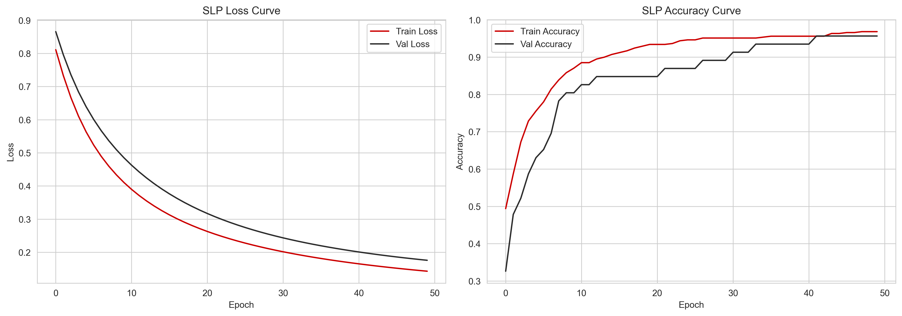
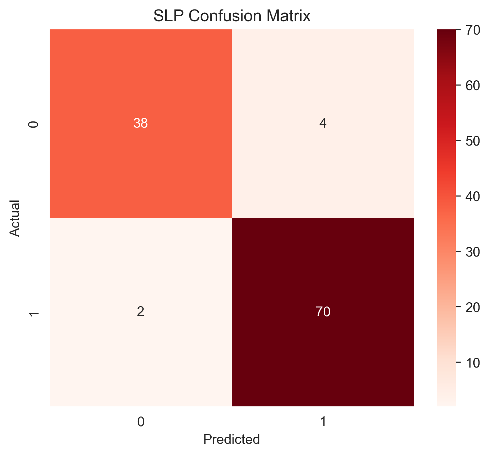
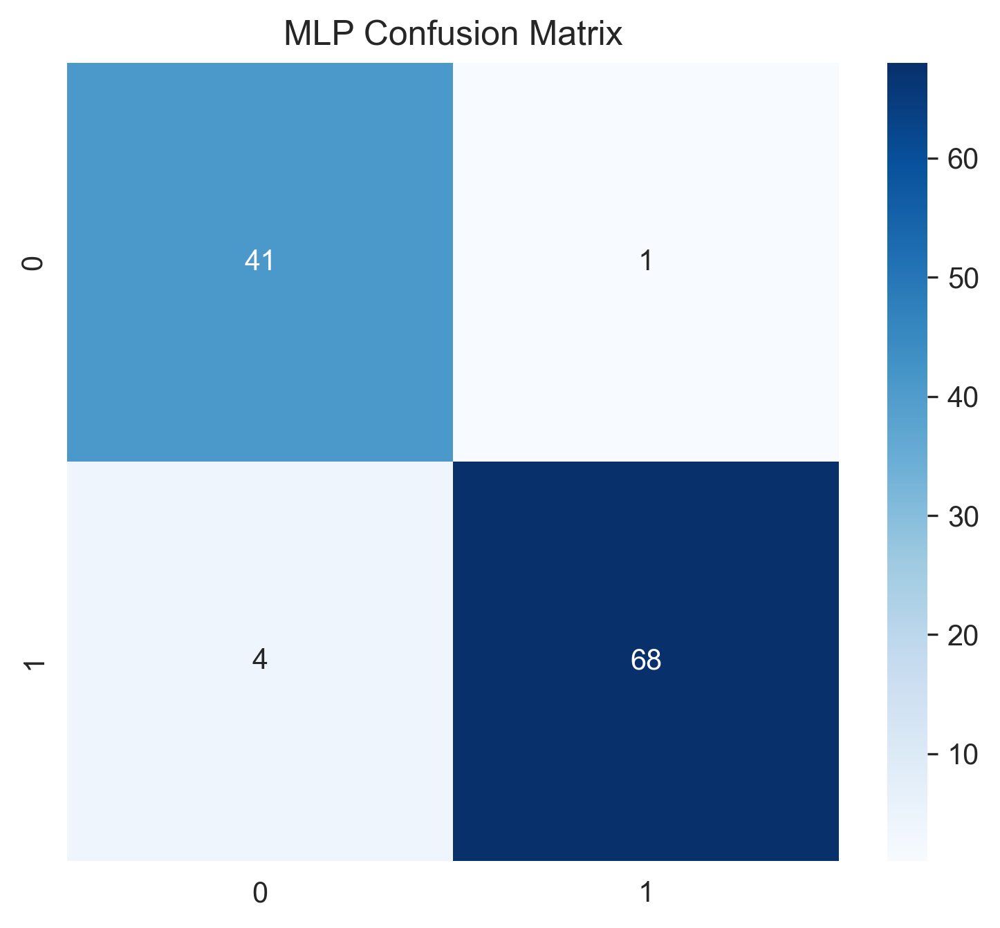
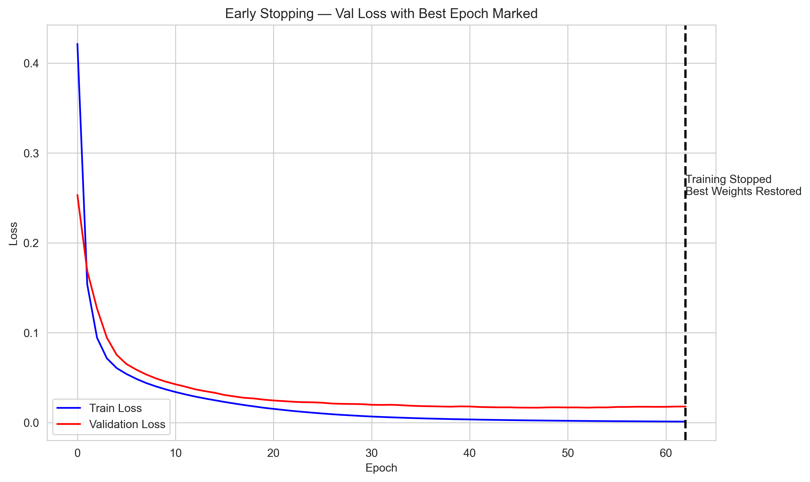
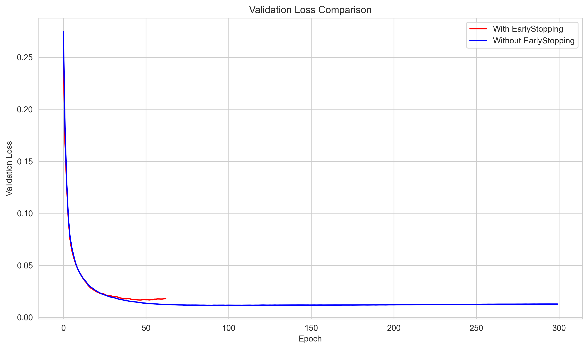
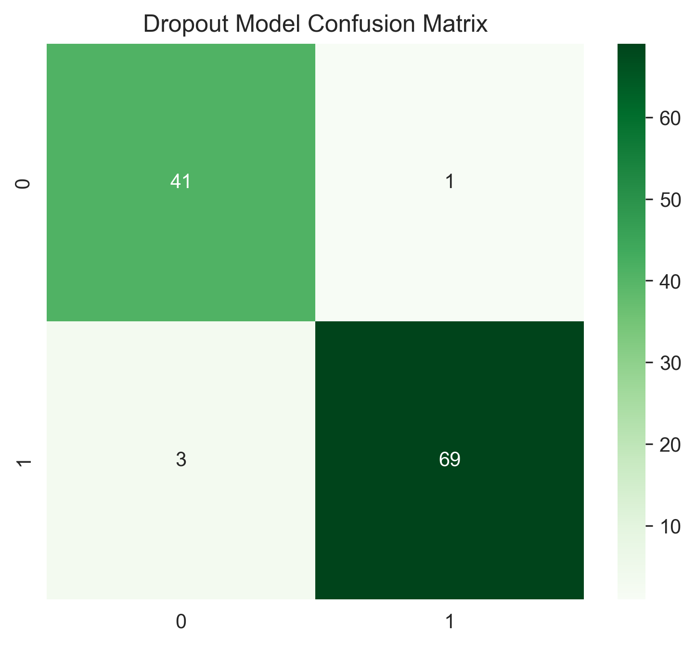
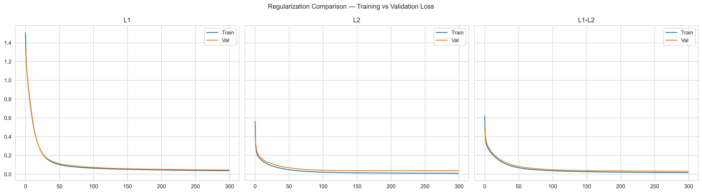
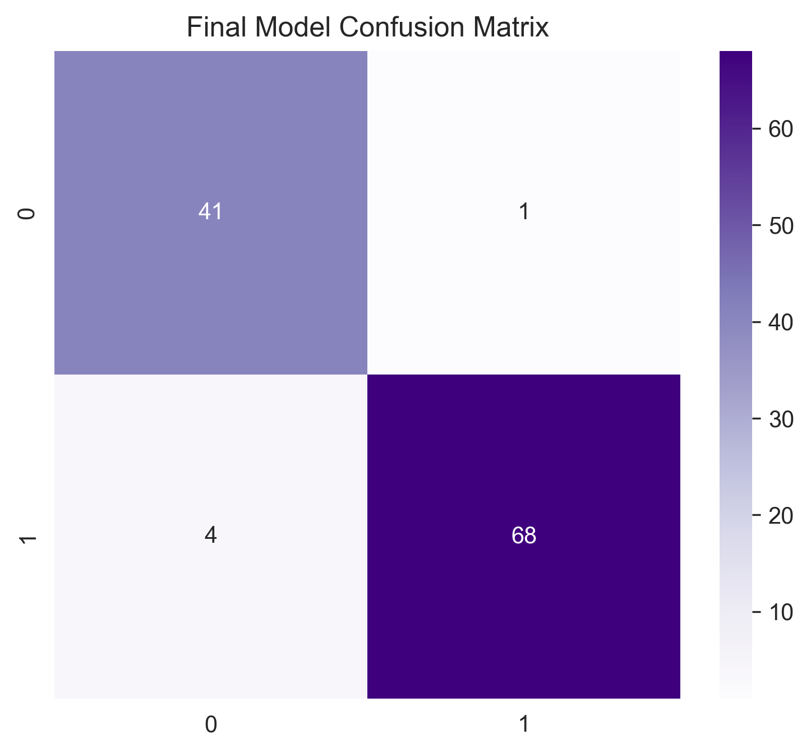

<div align="center">

# 🧠 Breast Cancer Classification Using Deep Learning

### Artificial Neural Networks • Model Optimization • Performance Evaluation

**Red & White Skill Education**

**Project by Misari Dhorajiya**

<br>


<br>

[📓 View Notebook](DL_PR1.ipynb) •
[📊 View HTML Report](DL_PR1.html) •
[💻 GitHub Repository](https://github.com/dhorajiyamisri/Deep-Learning-PR1)

</div>

---

## 📌 Table of Contents

- [Project Overview](#-project-overview)
- [Problem Statement](#-problem-statement)
- [Project Objectives](#-project-objectives)
- [Project Information](#-project-information)
- [Dataset Description](#-dataset-description)
- [Technologies Used](#-technologies-used)
- [Project Structure](#-project-structure)
- [Task 1: Exploratory Data Analysis](#-task-1-exploratory-data-analysis-and-preprocessing)
- [Task 2: Single-Layer Perceptron](#-task-2-single-layer-perceptron-slp)
- [Task 3: Multi-Layer Perceptron](#-task-3-multi-layer-perceptron-mlp)
- [Task 4: Early Stopping](#-task-4-early-stopping)
- [Task 5: Dropout Regularization](#-task-5-dropout-regularization)
- [Task 6: L1 and L2 Regularization](#-task-6-l1-and-l2-regularization)
- [Task 7: Final Combined Model](#-task-7-final-combined-model)
- [Visual Results](#-visual-results)
- [Model Evaluation](#-model-evaluation)
- [Project Workflow](#-project-workflow)
- [Installation and Execution](#-installation-and-execution)
- [Key Learnings](#-key-learnings)
- [Limitations](#-limitations)
- [Author](#-author)

---

## 🧠 Project Overview

Breast cancer is a major healthcare challenge, and identifying whether a tumor is malignant or benign is an important classification problem.

This project explores how **Artificial Neural Networks (ANNs)** and deep learning techniques can classify breast cancer diagnostic data into two categories. It begins with exploratory data analysis and preprocessing, then builds and evaluates neural network models while investigating techniques that can help improve generalization.

The project includes seven practical tasks, covering a simple neural network, a deeper neural network, activation functions, early stopping, dropout, regularization, and a final combined model.

> **Important:** This is an educational machine learning project, not a clinically validated diagnostic system. Its predictions must not be used as a substitute for professional medical evaluation.

## 🎯 Problem Statement

Build and evaluate neural network models that use numerical measurements from breast cancer diagnostic samples to predict whether a tumor is:

- **Malignant:** cancerous tumor; dataset label `0`.
- **Benign:** non-cancerous tumor; dataset label `1`.

The objective is to understand the complete deep learning workflow, evaluate classification performance, compare model configurations, and investigate methods to reduce overfitting.

## 🚀 Project Objectives

- Understand the structure and quality of the dataset.
- Perform exploratory data analysis (EDA).
- Visualize the target class distribution and feature correlations.
- Split data into training and testing sets.
- Standardize numerical features without leaking test-set information.
- Build a Single-Layer Perceptron (SLP).
- Develop a Multi-Layer Perceptron (MLP).
- Compare ReLU, Tanh, and Sigmoid activation functions.
- Study early stopping and its effect on training.
- Compare different dropout rates.
- Investigate L1, L2, and combined L1-L2 regularization.
- Develop a final combined neural network model.
- Evaluate models using appropriate classification metrics and confusion matrices.

## 🏫 Project Information

| Detail | Information |
|---|---|
| Institution | Red & White Skill Education |
| Student Name | Misari Dhorajiya |
| Project Title | Breast Cancer Classification Using Deep Learning |
| Domain | Artificial Intelligence / Deep Learning |
| Learning Approach | Supervised Learning |
| Problem Type | Binary Classification |
| Dataset | Breast Cancer Wisconsin Diagnostic dataset |
| Main Implementation | Jupyter Notebook |
| Repository | [Deep-Learning-PR1](https://github.com/dhorajiyamisri/Deep-Learning-PR1) |

## 📊 Dataset Description

This project uses the Breast Cancer Wisconsin Diagnostic dataset available through `sklearn.datasets.load_breast_cancer`.

The dataset contains measurements computed from digitized images of breast mass samples.

### Dataset summary

| Property | Description |
|---|---|
| Total samples | 569 |
| Numerical input features | 30 |
| Target classes | 2 |
| Malignant samples | 212 |
| Benign samples | 357 |
| Missing values | Verify during EDA |
| Task | Binary classification |

### Target variable

| Encoded value | Class | Meaning |
|---|---|---|
| `0` | Malignant | Cancerous |
| `1` | Benign | Non-cancerous |

The target encoding above follows the original scikit-learn dataset. Confirm that the notebook retains this mapping before interpreting model results.

### Feature categories

The 30 numerical features describe properties of cell nuclei, including:

- **Radius:** distances from the center to points on the perimeter.
- **Texture:** variation in grayscale values.
- **Perimeter:** boundary length.
- **Area:** estimated size.
- **Smoothness:** local variation in radius lengths.
- **Compactness:** relationship between perimeter and area.
- **Concavity:** severity of concave portions of the contour.
- **Concave points:** number or severity of concave boundary points.
- **Symmetry:** symmetry of the nucleus.
- **Fractal dimension:** complexity of the boundary.

Many of these measurements have mean, standard-error, and worst-value variants.

## 🛠️ Technologies Used

| Technology | Purpose |
|---|---|
| Python | Core programming language |
| NumPy | Numerical operations |
| Pandas | Data manipulation and tabular analysis |
| Matplotlib | Plotting and visualizations |
| Seaborn | Statistical visualizations and heatmaps |
| Scikit-learn | Dataset loading, splitting, scaling, and evaluation |
| TensorFlow / Keras | Neural network construction and training, if used in the notebook |
| Jupyter Notebook | Interactive experimentation |
| VS Code | Development environment |
| Git and GitHub | Version control and project hosting |

## 📁 Project Structure

```text
Deep-Learning-PR1/
│
├── DL_PR1.ipynb
│   └── Main notebook containing the practical tasks
│
├── DL_PR1.html
│   └── Exported notebook report
│
├── README.md
│   └── Project documentation
│
├── requirements.txt
│   └── Python dependencies
│
└── plots/
    ├── class_distribution.png
    ├── correlation_heatmap.png
    ├── slp_training_curves.png
    ├── activation_comparison.png
    ├── early_stopping_curve.png
    ├── early_stopping_vs_normal.png
    ├── dropout_comparison.png
    ├── dropout_confusion_matrix.png
    ├── slp_confusion_matrix.png
    ├── mlp_confusion_matrix.png
    ├── final_model_confusion_matrix.png
    ├── regularization_accuracy.png
    └── regularization_comparison.png
```

*Note: The tree describes the intended project structure. Keep only files that actually exist in your repository, and ensure every plot filename matches the real file.*

---

## 🔍 Task 1: Exploratory Data Analysis and Preprocessing

The first task focuses on understanding the dataset and preparing it for neural network training.

### Step 1: Load the dataset

Load the Breast Cancer Wisconsin Diagnostic dataset and organize the features and target labels.

```python
from sklearn.datasets import load_breast_cancer
import pandas as pd

dataset = load_breast_cancer()

X = pd.DataFrame(
    dataset.data,
    columns=dataset.feature_names
)

y = pd.Series(dataset.target, name="target")

print("Dataset shape:", X.shape)
print("Target shape:", y.shape)
print(X.head())
```

### Step 2: Inspect and clean the data

Check the dataset dimensions, data types, duplicate records, and missing values. Handle any issues if discovered.

### Step 3: Analyze the target distribution

Visualize malignant and benign sample counts to understand class balance.


*Insight:* The dataset contains more benign than malignant samples. Evaluating precision, recall, F1-score, and the confusion matrix alongside accuracy provides a more informative view of classification performance.

### Step 4: Explore feature correlations

A correlation heatmap helps identify relationships between numerical features.


*Insight:* Some diagnostic measurements may be strongly correlated. This is useful for understanding the dataset, although correlation alone does not establish causation or determine which features a neural network will use.

### Step 5: Split and standardize the data

Use a stratified training/testing split so that the class proportions are approximately preserved.

```python
from sklearn.model_selection import train_test_split
from sklearn.preprocessing import StandardScaler

X_train, X_test, y_train, y_test = train_test_split(
    X,
    y,
    test_size=0.20,
    random_state=42,
    stratify=y
)

scaler = StandardScaler()

X_train_scaled = scaler.fit_transform(X_train)
X_test_scaled = scaler.transform(X_test)

print("Training samples:", X_train_scaled.shape[0])
print("Testing samples:", X_test_scaled.shape[0])
```

**Why standardization?**

Features with different numerical scales can make neural network optimization more difficult. `StandardScaler` learns its statistics from training data and applies those same statistics to the test data, preventing test-set leakage.

---

## 🧩 Task 2: Single-Layer Perceptron (SLP)

A Single-Layer Perceptron provides a simple neural network baseline for binary classification.

### Model concept

- Input: 30 standardized numerical features.
- Output: one sigmoid neuron.
- Loss: binary cross-entropy.
- Optimizer: Adam.
- Evaluation: classification report and confusion matrix.

The sigmoid output represents a score between 0 and 1, which can be converted into a class prediction using a threshold.

### Training visualization



*Interpretation:* Training and validation curves help assess learning progress. A growing gap between training and validation performance may indicate overfitting; persistently poor performance on both may indicate underfitting.

### Confusion matrix



A confusion matrix summarizes correct and incorrect predictions for each class. Pay particular attention to malignant samples incorrectly classified as benign.

**Expected learning outcome:** Establish a baseline and understand how a simple neural network performs before introducing hidden layers and regularization.

---

## 🧠 Task 3: Multi-Layer Perceptron (MLP)

A Multi-Layer Perceptron adds hidden layers to learn more complex relationships between input features and target labels.

### Example architecture

```text
30 Input Features
        │
        ▼
Dense Layer: 64 Neurons, ReLU
        │
        ▼
Dense Layer: 32 Neurons, ReLU
        │
        ▼
Output Layer: 1 Neuron, Sigmoid
        │
        ▼
Malignant / Benign Prediction
```

The exact architecture used for evaluation should match the model definition in the notebook.

### Activation function comparison

The practical compares:

- **ReLU:** introduces non-linearity and is commonly used in hidden layers.
- **Tanh:** maps activations into the range -1 to 1.
- **Sigmoid:** maps activations into the range 0 to 1 and is commonly used for binary output.


*Interpretation:* Compare the validation curves and classification metrics rather than assuming one activation function will always perform best. The outcome depends on the model configuration and training process.

### MLP confusion matrix



**Expected learning outcome:** Understand how hidden layers and activation functions influence model capacity and classification performance.

---

## ⏹️ Task 4: Early Stopping

Early stopping monitors validation performance during training and stops the process when the monitored metric no longer improves sufficiently.

### Why use early stopping?

- Helps limit unnecessary training.
- Can reduce overfitting.
- Can restore the model weights from the best validation epoch when configured to do so.
- Reduces wasted computation when training has stopped improving.

### Training curve



### Normal training versus early stopping



*Interpretation:* Compare training duration and validation behavior. Early stopping is useful when the validation metric plateaus or worsens, but it does not guarantee better test performance in every experiment.

---

## 💧 Task 5: Dropout Regularization

Dropout randomly disables a proportion of units during training. This encourages the model not to rely too heavily on a small number of neurons.

### Dropout experiments

The practical compares multiple dropout configurations. Check the notebook for the exact dropout rates used.


### Dropout confusion matrix



*Interpretation:* Compare validation behavior and classification metrics across configurations. A larger dropout rate is not automatically better; too much dropout can prevent the network from learning useful patterns.

**Expected learning outcome:** Understand how dropout can help control overfitting and why regularization strength must be selected carefully.

---

## 🛡️ Task 6: L1 and L2 Regularization

Regularization adds a penalty to the loss function to discourage unnecessarily complex weight configurations.

### L1 Regularization

L1 regularization penalizes the absolute values of model weights. It can encourage some weights to become exactly or approximately zero.

### L2 Regularization

L2 regularization penalizes squared weight values. It discourages large weights and is commonly used to improve generalization.

### Combined L1-L2 Regularization

A combined penalty uses both L1 and L2 components. Its effect depends on the regularization strengths and the model configuration.

### Regularization accuracy comparison


### Regularization comparison



*Interpretation:* Compare the plotted training and validation metrics, where available. Select the approach based on validation behavior and test-set evaluation rather than assuming that any regularization method will always improve results.

---

## 🏆 Task 7: Final Combined Model

The final task brings together the techniques explored in the earlier experiments.

Depending on the final notebook implementation, the combined model may include:

- A multi-layer neural network.
- A selected activation configuration.
- Dropout layers.
- L1, L2, or combined regularization.
- Early stopping.
- Final evaluation on the held-out test set.

### Final model evaluation

The final model should be evaluated on test data that was not used to fit the model or select its weights.

Recommended evaluation outputs include:

- Accuracy
- Precision
- Recall
- F1-score
- Confusion matrix
- Training and validation curves

### Final confusion matrix



*Interpretation:* Review both classes independently, especially malignant cases predicted as benign. Overall accuracy alone cannot show the full impact of different types of classification errors.

---

## 📈 Visual Results

The following gallery brings together the main visualizations produced throughout the practical tasks.

| Visualization | What it shows |
|---|---|
| Class distribution | Number of samples in each class |
| Correlation heatmap | Relationships between numerical features |
| SLP training curves | Learning and validation behavior |
| Activation comparison | Behavior of different activation configurations |
| Early stopping curve | Validation monitoring during training |
| Early stopping vs normal | Comparison of training approaches |
| Dropout comparison | Performance across dropout configurations |
| SLP confusion matrix | Classification errors for the baseline |
| MLP confusion matrix | Classification errors for the deeper network |
| Dropout confusion matrix | Classification errors after dropout |
| Regularization accuracy | Accuracy across regularization experiments |
| Regularization comparison | Comparison of regularized configurations |
| Final model confusion matrix | Final classification results |

### Complete visualization gallery

<div align="center">

<table>
<tr>
<td align="center" width="50%">

**1. Class Distribution**


</td>
<td align="center" width="50%">

**2. Correlation Heatmap**


</td>
</tr>
<tr>
<td align="center" width="50%">

**3. SLP Training Curves**


</td>
<td align="center" width="50%">

**4. Activation Comparison**


</td>
</tr>
<tr>
<td align="center" width="50%">

**5. Early Stopping Curve**


</td>
<td align="center" width="50%">

**6. Early Stopping vs Normal**


</td>
</tr>
<tr>
<td align="center" width="50%">

**7. Dropout Comparison**


</td>
<td align="center" width="50%">

**8. Dropout Confusion Matrix**


</td>
</tr>
<tr>
<td align="center" width="50%">

**9. SLP Confusion Matrix**


</td>
<td align="center" width="50%">

**10. MLP Confusion Matrix**


</td>
</tr>
<tr>
<td align="center" width="50%">

**11. Final Model Confusion Matrix**


</td>
<td align="center" width="50%">

**12. Regularization Accuracy**


</td>
</tr>
<tr>
<td align="center" width="50%">

**13. Regularization Comparison**


</td>
<td align="center" width="50%">

*All plots are generated by the project notebook.*

</td>
</tr>
</table>

</div>

---

## 📋 Model Evaluation

Use the table below to record the **actual results from the executed notebook**. Do not fill in estimated or invented values.

| Model / Experiment | Test Accuracy | Precision | Recall | F1-Score |
|---|---:|---:|---:|---:|
| Single-Layer Perceptron | — | — | — | — |
| Multi-Layer Perceptron | — | — | — | — |
| Early Stopping Model | — | — | — | — |
| Dropout Model | — | — | — | — |
| Regularized Model | — | — | — | — |
| Final Combined Model | — | — | — | — |

**Before submission:** Replace the dashes with the corresponding values from the final notebook outputs, using the same positive-class definition consistently for precision, recall, and F1-score.

### How to interpret the metrics

- **Accuracy:** Proportion of all predictions that are correct.
- **Precision:** Among the samples predicted as positive, the proportion that are truly positive.
- **Recall:** Among the actual positive samples, the proportion correctly identified.
- **F1-score:** Harmonic mean of precision and recall.
- **Confusion matrix:** Shows the counts of correct and incorrect predictions for each class.

For this dataset, explicitly report which class is considered positive. In a medical classification context, malignant-class recall is particularly important to inspect.

---

## 🔄 Project Workflow

```text
Dataset Loading
      ↓
Data Inspection and EDA
      ↓
Class Distribution and Correlation Analysis
      ↓
Train-Test Split
      ↓
Feature Standardization
      ↓
Single-Layer Perceptron
      ↓
Multi-Layer Perceptron
      ↓
Activation Function Comparison
      ↓
Early Stopping Experiments
      ↓
Dropout Experiments
      ↓
L1 / L2 / L1-L2 Regularization
      ↓
Final Combined Model
      ↓
Test-Set Evaluation and Visualization
```

## ⚙️ Installation and Execution

### Prerequisites

- Python installed on your computer.
- VS Code or Jupyter Notebook.
- Git, if cloning the repository.
- Required Python packages.

### Step 1: Clone the repository

```bash
git clone https://github.com/dhorajiyamisri/Deep-Learning-PR1.git
```

### Step 2: Open the project directory

```bash
cd Deep-Learning-PR1
```

### Step 3: Create a virtual environment (recommended)

```bash
python -m venv .venv
```

On Windows Command Prompt:

```bash
.venv\Scripts\activate
```

### Step 4: Install dependencies

If `requirements.txt` exists:

```bash
python -m pip install -r requirements.txt
```

Otherwise, install the libraries actually imported by your notebook. For example:

```bash
python -m pip install numpy pandas matplotlib seaborn scikit-learn tensorflow jupyter nbconvert
```

*If the notebook uses a different deep learning framework, adjust the dependencies accordingly.*

### Step 5: Run the notebook

```bash
jupyter notebook DL_PR1.ipynb
```

Alternatively, open `DL_PR1.ipynb` directly in VS Code and select the Python environment containing the project dependencies.

### Step 6: Execute all cells

Run the notebook from top to bottom. Confirm that:

- All imports work.
- Every model is defined before it is evaluated.
- All seven practical tasks execute without errors.
- Plot images are generated successfully.
- Final metrics match the values recorded in the README.

### Step 7: Review the HTML report

Open `DL_PR1.html` in a browser to review the exported notebook report.

---

## 💡 Key Learnings

Through this project, the following concepts are explored:

1. Understanding a real-world binary classification dataset.
2. Performing EDA and interpreting visualizations.
3. Applying train-test splitting and feature standardization.
4. Understanding neural network input, hidden, and output layers.
5. Comparing activation functions.
6. Monitoring training and validation curves.
7. Understanding overfitting and early stopping.
8. Exploring dropout as a regularization technique.
9. Comparing L1, L2, and combined regularization.
10. Evaluating classification results with multiple metrics.
11. Understanding why model evaluation must be performed on unseen test data.

## ⚠️ Limitations

- This project is an educational experiment, not a certified medical diagnostic tool.
- The dataset is limited in size and may not represent every patient population or clinical setting.
- Performance on this dataset does not guarantee performance on new clinical data.
- Model selection should be based on validation results and an appropriate evaluation strategy.
- Class-specific errors, particularly malignant cases predicted as benign, require careful review.
- Further external validation and clinical assessment would be necessary before any real-world medical use.

## 🔮 Future Improvements

- Add systematic hyperparameter tuning.
- Compare neural networks with traditional machine learning baselines.
- Evaluate calibration and class-specific metrics.
- Use cross-validation for more reliable model comparisons.
- Improve experiment tracking and reproducibility.
- Develop an interactive educational interface for exploring predictions.
- Add a clear model card describing training data, intended use, and limitations.

## 👩‍💻 Author

**Misari Dhorajiya**

Student at **Red & White Skill Education**

Interested in Data Science, Artificial Intelligence, Machine Learning, and Deep Learning.

- **GitHub:** [@dhorajiyamisri](https://github.com/dhorajiyamisri)
- **Project Repository:** [Deep-Learning-PR1](https://github.com/dhorajiyamisri/Deep-Learning-PR1)

---

<div align="center">

### ⭐ If you find this project useful, consider giving the repository a star!

**Built for learning, experimentation, and understanding Deep Learning.**

</div>
