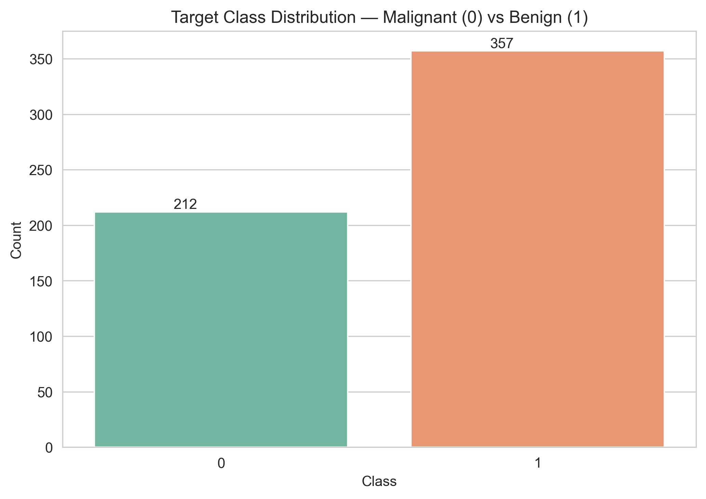
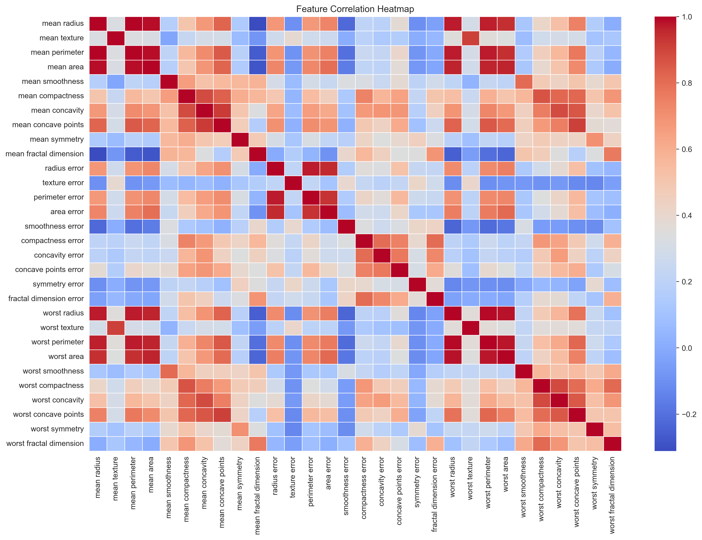
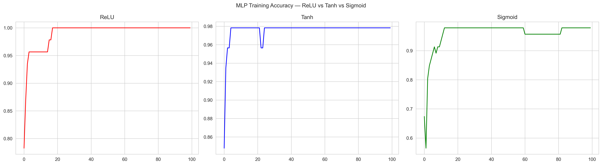
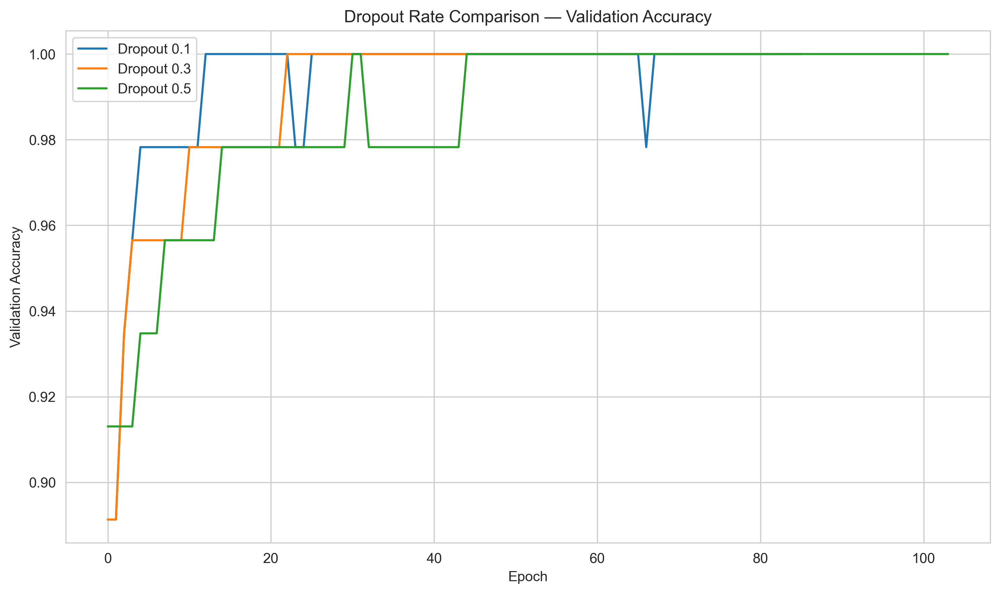
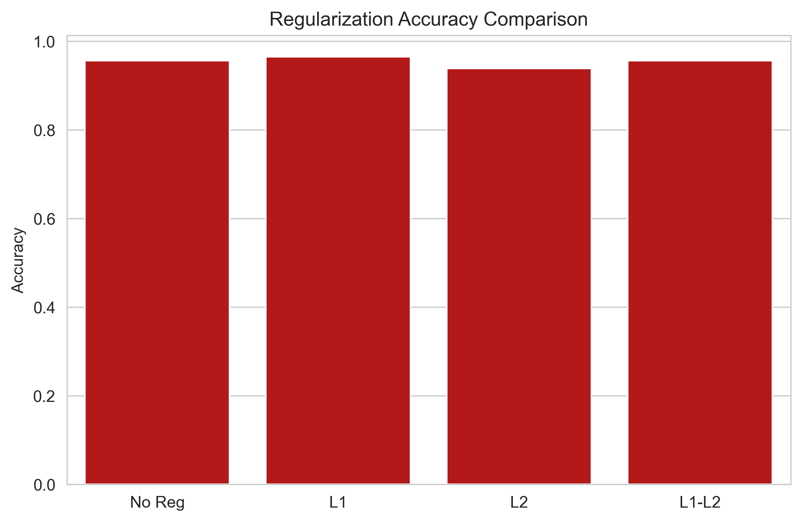

# 🧠 Deep Learning PR1
### Breast Cancer Classification with Neural Networks

<p align="center">
  
  
  
  
</p>

<p align="center">
  A hands-on exploration of neural networks, activation functions, and regularization techniques for binary breast cancer classification.
</p>

<p align="center">
  <a href="DL_PR1.ipynb">📓 View Notebook</a> •
  <a href="DL_PR1.html">🌐 View HTML Report</a> •
  <a href="plots/">📊 Explore Visualizations</a>
</p>

---

## ✨ Project Overview

This project investigates how neural network architectures and regularization strategies affect classification performance on the Breast Cancer Wisconsin Diagnostic dataset.

The notebook progresses from exploratory data analysis to neural network training, performance evaluation, and a final combined-model experiment.

> **Educational purpose:** This model is not intended for clinical diagnosis or medical decision-making.

## 🎯 Project Objectives

- Explore the dataset and understand its class distribution.
- Build a Single Layer Perceptron (SLP) and a Multi-Layer Perceptron (MLP).
- Compare activation functions.
- Investigate Early Stopping and Dropout.
- Compare L1, L2, and combined regularization.
- Evaluate models using classification metrics and confusion matrices.

## 📦 Dataset at a Glance

| Property | Details |
|---|---|
| Dataset | Breast Cancer Wisconsin Diagnostic |
| Source | `scikit-learn` |
| Samples | 569 |
| Input features | 30 |
| Target | Binary classification |
| Class 0 | Malignant |
| Class 1 | Benign |
| Split | 80% training / 20% testing |
| Scaling | StandardScaler fitted on training data |

## 🗺️ Deep Learning Workflow

1. Data exploration and visualization
2. Stratified train-test split
3. Feature standardization
4. Single Layer Perceptron
5. Multi-Layer Perceptron and activation comparison
6. Early Stopping experiments
7. Dropout experiments
8. L1 / L2 regularization experiments
9. Final model evaluation

## 📊 Visual Results Gallery

> Replace the example paths below with the exact image filenames inside your `plots/` folder. Keep only sections for plots that actually exist in the repository.

### 01 — Exploratory Data Analysis

**Class Distribution**



**Feature Correlation Heatmap**



### 02 — Single Layer Perceptron

**Training and Validation Performance**


### 03 — Multi-Layer Perceptron

**Activation Function Comparison**



### 04 — Early Stopping

**Baseline vs Early Stopping**


### 05 — Dropout Regularization

**Dropout Rate Comparison**



### 06 — L1 and L2 Regularization

**Regularization Loss Curves**


**Test Accuracy Comparison**



### 07 — Final Model

**Final Model Evaluation**

See the notebook and HTML report for the final confusion matrix, classification report, and combined-model comparison.

## 🧪 Experiments Covered

| Experiment | Main focus |
|---|---|
| SLP | Baseline neural network |
| MLP | Hidden layers and nonlinear learning |
| Activation functions | ReLU, Tanh, and Sigmoid comparison |
| Early Stopping | Monitoring validation loss |
| Dropout | Reducing overfitting |
| L1 regularization | Penalizing absolute weights |
| L2 regularization | Penalizing squared weights |
| Combined model | Integrating regularization techniques |

## 📈 Evaluation Metrics

Model performance should be interpreted using multiple metrics:

- **Accuracy:** Overall proportion of correct predictions.
- **Precision:** Proportion of predicted positive cases that are correct.
- **Recall:** Proportion of actual positive cases correctly identified.
- **F1-score:** Harmonic mean of precision and recall.
- **Confusion matrix:** Breakdown of correct and incorrect predictions.

For medical classification tasks, false negatives and false positives have different consequences. Metric interpretation must therefore consider which class is treated as positive.

## 🛠️ Tech Stack

- Python
- NumPy and Pandas
- Matplotlib and Seaborn
- Scikit-learn
- TensorFlow / Keras
- Jupyter Notebook

## 🚀 Getting Started

### 1. Clone the repository

```bash
git clone https://github.com/dhorajiyamisri/Deep-Learning-PR1.git
cd Deep-Learning-PR1
```

### 2. Install dependencies

```bash
python -m pip install -r requirements.txt
```

### 3. Run the notebook

Open `DL_PR1.ipynb` in VS Code or Jupyter Notebook, select the appropriate Python environment, and run the cells in order.

## 📁 Repository Structure

```text
Deep-Learning-PR1/
├── DL_PR1.ipynb
├── DL_PR1.html
├── requirements.txt
├── README.md
└── plots/
    └── project visualizations
```

## 💡 Key Learnings

- Why stratified splitting helps preserve class proportions.
- Why feature scaling matters for neural network training.
- How hidden layers and activation functions affect model learning.
- How Early Stopping and Dropout can help control overfitting.
- How L1 and L2 regularization influence model complexity.
- Why classification metrics should be considered together.

## 👩‍💻 Author

**Misari Dhorajiya**

GitHub: [@dhorajiyamisri](https://github.com/dhorajiyamisri)

---

<p align="center">
  <i>Built as a practical learning project in Deep Learning.</i>
</p>
